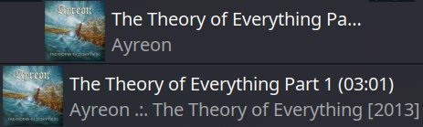

# PlasmaMediaControlEdit

## Extended Media Control Plasma Widget (Plasma 5 & Plasma 6)

A modified KDE Media Player widget displaying extra track metadata on the panel:
* **Line 1:** Track number, title, and length (`11. Song Title (03:45)`)
* **Line 2:** Artist, album, and year (`Artist .:. Album Name [2013]`)
* **Plasma 6 Features:** Smart sizing, synchronized marquee scrolling for long text, and native MPRIS D-Bus metadata lookup (`xesam:trackNumber`, `year`, `xesam:contentCreated`) without external dependencies. *(Plasma 5 version expands without truncation.)*



---

### Installation

#### KDE Plasma 6 (`plasma6/`)
```bash
mkdir -p ~/.local/share/plasma/plasmoids/
cp -r plasma6/com.github.martrewes.mediacontrol ~/.local/share/plasma/plasmoids/
systemctl --user restart plasma-plasmashell.service
```

#### KDE Plasma 5 (`plasma5/`)
```bash
mkdir -p ~/.local/share/plasma/plasmoids/
cp -r plasma5/com.github.martrewes.mediacontrol ~/.local/share/plasma/plasmoids/
kquitapp5 plasmashell && kstart5 plasmashell
```

---

### TODO

- [x] Make Plasma 6 Compatible (separate `plasma6/` and `plasma5/` versions)
- [x] Add track numbers
- [x] Distinct widget identification
- [x] Max width cap with synchronized marquee scrolling
