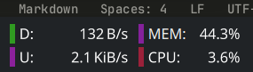
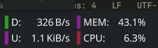

# ksysguard_TextOnly_Mini

This is a **very minor** modification to the default Text Only sensor for KDE Plasma 6. It allows the text only network speed monitor to use less space on the panel. This was created for the sole purpose to look more in line with the CPU and Memory stats in the same panel.




## How to use

Just copy/paste the `ksysguard` folder into `~/.local/share/` and restart plasma with:

```bash
systemctl --user restart plasma-plasmashell.service
```
